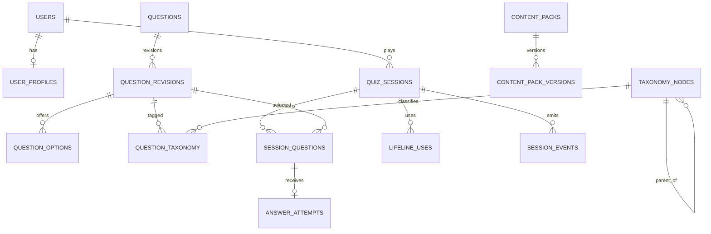

# Domain Model and Database Specification

## Design rules
PostgreSQL is the system of record for users, optional profiles, taxonomy, pack metadata, sessions, attempts, lifeline usage, progress and audit. Pack bytes live in immutable object storage. Use UUIDs, UTC timestamptz, constraints and migrations. Approved question revisions and published pack versions are immutable. Session records pin exact content and selection-policy versions.

## Entities and relationships
- users 1:1 user_profiles; users 1:N quiz_sessions and user_topic_progress.
- taxonomy_nodes form a parent-child tree and are linked to questions and profile interests.
- content_packs 1:N content_pack_versions; pack versions contain question revisions and are referenced by sessions.
- questions 1:N question_revisions; revisions 1:N question_options and N:M taxonomy, perspectives and learning objectives.
- quiz_sessions 1:N session_questions; session_questions 1:0..1 answer_attempts.
- quiz_sessions 1:N lifeline_uses and session_events.
- content_publications track environment-specific active pack history; admin_audit_events record privileged changes.

## Core tables
See `engineering/sql/001_initial_schema.sql` for executable starter DDL. Important constraints:
- unique question key and unique (question_id, revision_no);
- unique (session_id, position) and no repeated revision in a session;
- unique answer attempt per session question and idempotency key;
- score and mastery bounded non-negative;
- taxonomy parent cannot be deleted while children or questions reference it;
- pack version checksum and (pack_id, version) unique.

## Integrity/lifecycle
1. Question correction creates a new immutable revision.
2. Pack correction creates a new immutable pack version.
3. A session pins pack version, revision IDs and selection policy at creation.
4. Accepted answer is transactional and unique; duplicate request returns original result.
5. Progress is a rebuildable projection from immutable attempts.
6. Guest bearer token is high entropy; store only a hash.
7. Answer-key material is never included in client-facing records or public CDN assets.

## Indexing and scale
Index user session history, session status/expiry, taxonomy parent/sort, pack lifecycle, session event time and audit target/time. Add indexes based on query plans, not speculation. Partition append-only session_events only after volume warrants it. Use connection pooling and short transactions; never hold a DB transaction during LLM or object-storage calls.

## ERD

## Migration strategy
Use Alembic. Prefer expand/contract migrations; deploy compatible code before enforcing constraints or removing old columns. Seed controlled vocabularies through repeatable migrations. Test against production-like data and rehearse rollback.